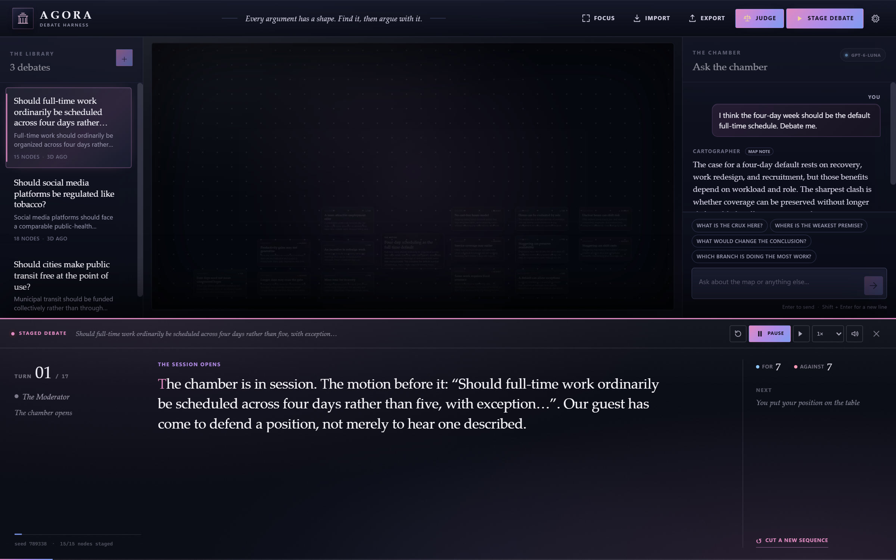
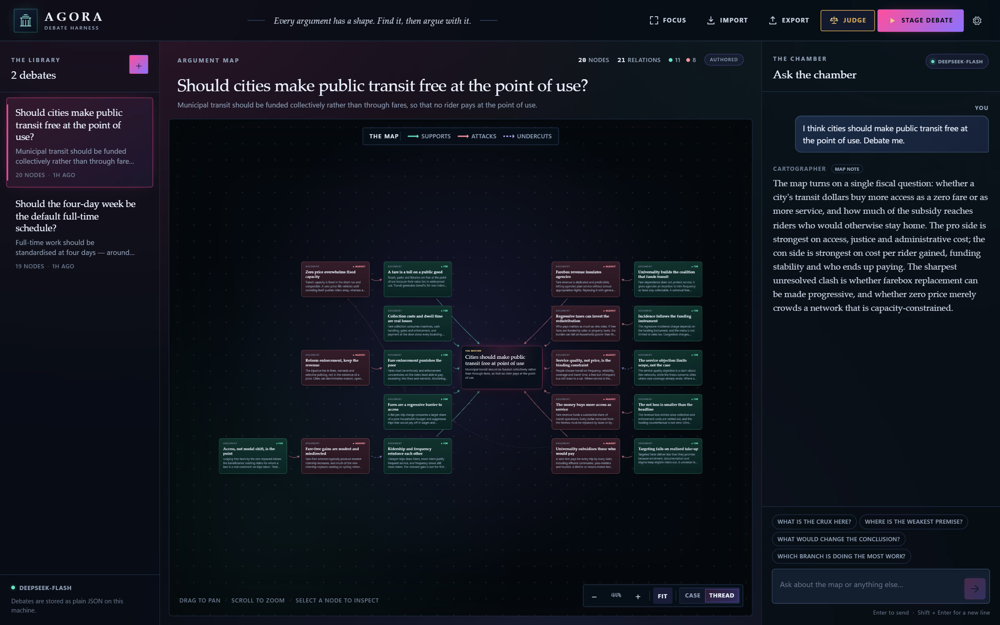
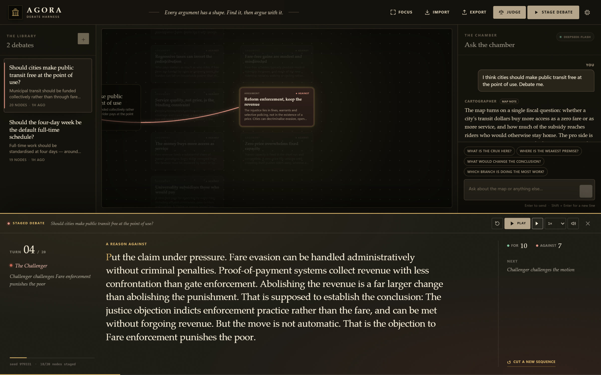
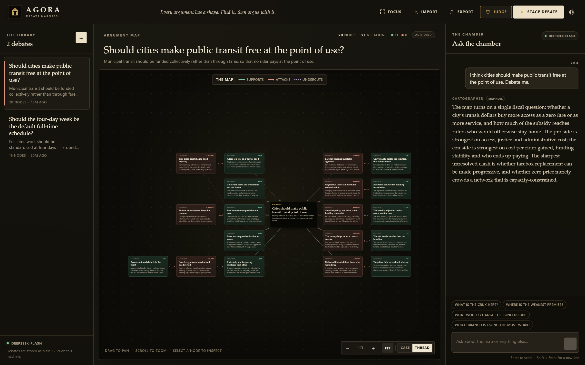
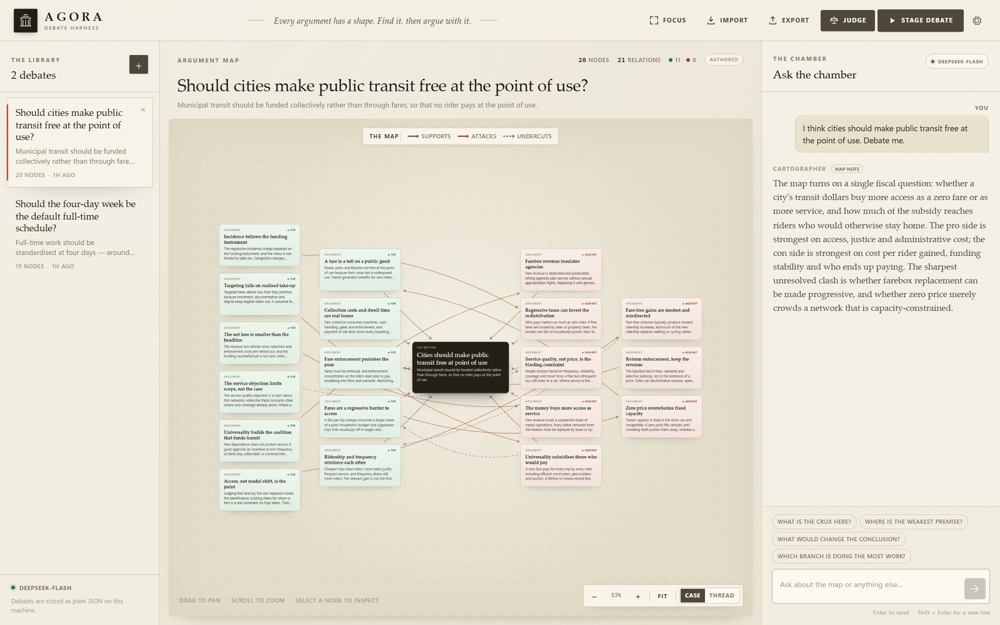
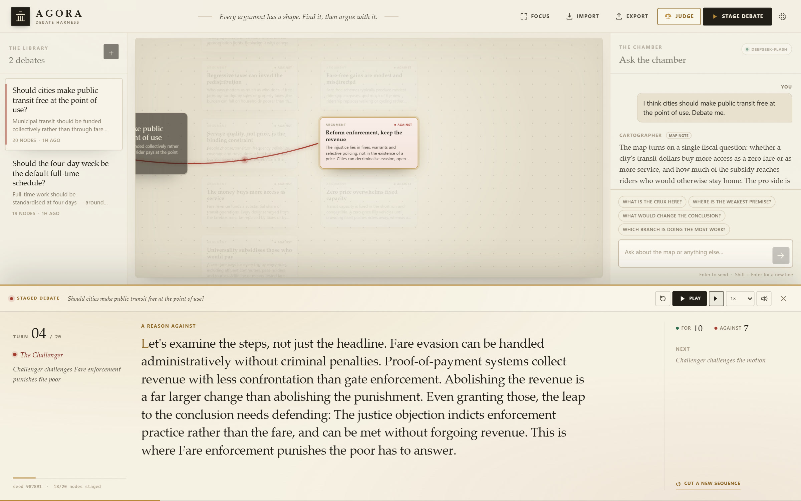
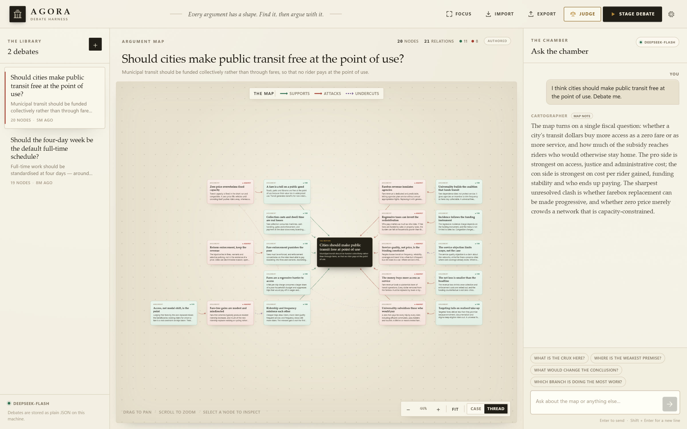

# Agora — a debate harness

> Every argument has a shape. Find it, then argue with it.

Agora turns a position into a map of arguments, lets you interrogate that map, exports it as **Argdown**, stages the debate as a sequence of turns with a live camera on the graph, and then **convenes a bench** to judge it: a model assesses each argument link locally, deterministic code aggregates the case, and the map shows arguments falling, surviving, or returning until the motion stands or falls.

It is built in the spirit of a learning harness: the model is not there to agree with you. It builds the strongest case for your position, the strongest case against it, and the places where the two actually collide.

## Status

Agora is an early public beta. The source is available under the **MIT License**. The Windows build is intentionally unsigned, has no auto-update, and has no dedicated website yet. OpenAI, DeepSeek, Claude, and Gemini have been live-tested against real accounts. Compatibility is strongest with current model IDs; older or retired models may fail, and **Max** thinking is not consistently reliable. xAI/Grok has not yet been live-tested. Read [`SECURITY.md`](SECURITY.md) before installing.

## Screenshots

Agora ships with three appearances. The gallery leads with **Aurora**, a cool low-light palette; **Night Reading Room** and the light **Editorial paper** set are folded out below it.

### Aurora


*The workspace in Aurora: cool paper, neon-ink highlights, and the argument map at the centre.*



*The stage in Aurora: midnight light, a cool reading surface, and the same argument map following the turn.*



*Thread view in Aurora: replies attach to the argument they answer, so a line of reasoning can be followed outward from the motion.*

<details>
<summary><strong>Night Reading Room — warm dark</strong></summary>


*The workspace in Night Reading Room.*



*The stage in Night Reading Room.*



*Thread view in Night Reading Room.*

</details>

<details>
<summary><strong>Editorial paper — light mode</strong></summary>



*The workspace in Editorial paper.*



*The stage in Editorial paper.*



*Thread view in Editorial paper.*

</details>

## Install on Windows

Download from the [GitHub Releases](https://github.com/andreasamundsen/agora/releases) page:

- `Agora-Setup-0.1.61.exe`
- `Agora-Setup-0.1.61.exe.sha256`

1. Back up `%APPDATA%\Agora\data` if you already have debates.
2. Close Agora, then run the installer. It is per-user and does not require administrator rights.
3. Windows SmartScreen will warn that the publisher is unknown. This build is intentionally unsigned: choose **More info → Run anyway**.
4. Verify the download against the checksum from the same release:

   ```powershell
   Get-FileHash .\Agora-Setup-0.1.61.exe -Algorithm SHA256
   ```

A matching hash confirms the file has not changed; it is not a code signature. There is no auto-update, so a future beta is a manual download and install.

The app stores its data under `%APPDATA%\Agora\data`, not in the repository's `data/` directory. Settings, including the API key, are stored there as plain JSON; use a dedicated key you can rotate.

## Run from source

Requirements: **Node 22.12+** and npm. The project is developed on Node 26.

```bash
npm install
npm run dev
```

Open <http://localhost:5173>. For a production-style run:

```bash
npm run build
npm start
```

`npm start` serves the built client and the API from one Node process. The server binds to `127.0.0.1` by default. Set `HOST=0.0.0.0` only if you deliberately want to expose it on your network; the API has no authentication and is intended for a single-user machine.

To build the Windows installer from source:

```bash
npm run dist
```

This produces `release/Agora-Setup-<version>.exe` and an NSIS blockmap. The installer bundles Electron and the compiled server, so users do not need Node. `npm run electron` runs the desktop shell directly; `npm run pack` produces an unpacked build for inspection.

The app works **before you connect a model**. It seeds two reference debates on first run, and the local scaffolder can still author maps, clearly labelled as a scaffold. A connected model makes the arguments topic-specific.

## Using Agora

### The library

Every debate is stored as plain JSON under `data/debates/`. Click a card to open it; use `×` to remove it.

### The map

The map is a pan/zoom argument graph. The thesis sits in the centre.

- **Case view** groups direct pro arguments on the left and direct con arguments on the right.
- **Thread view** keeps those direct cases in place but attaches each response to the argument it answers, extending the reply chain outward on that argument's side. Replies share vertical space, so Thread view stays close to Case view's height. A con reply can sit on the pro side where its target lives; the card's For/Against badge and colour carry the stance.
- Dense maps open as a complete overview; small maps open at a readable scale. Drag to pan, scroll to zoom, and use **Fit** to recover the whole shape.
- The static map refits when the window changes size. After a manual pan or zoom it preserves your view until you press **Fit**.
- Select a card for the inspector: full text, premises, conclusion, and relations.
- **Edit map** opens a separate draft editor. Read mode has no per-card action buttons.

### Editing the map

`Edit map` changes the map from a reading surface into a draft. Nothing is written until **Done**; **Cancel** restores the saved map. The motion is edit-only: it is the root claim, so it cannot be added or removed.

- Every argument exposes kind (argument or statement), title, text, premises, conclusion, and tags. The motion exposes the same content fields.
- **Side** and **speaker** are derived from the graph, not separate fields. Change the relation that places an argument to change its side; the editor shows the result before you save.
- **Add response** creates an argument and its relation in one step. **Link existing** attaches the selected argument to another card or the motion. Relation types can be changed between support, attack, and undercut, and relations can be removed.
- **Remove argument** removes the card and its incident relations. The editor refuses to remove the motion, to strand a response whose only path is through a removed argument, or to remove the only relation that keeps a card connected.
- Links that would create a loop are refused.
- `Undo` / `Redo` stay inside the draft; `Ctrl+Z` / `Ctrl+Shift+Z` and `Delete` work when focus is not in a form field. `Esc` cancels an unfocused draft.

Edits are saved through the same atomic debate-store path as the rest of the app and preserve the debate's chat, origin, and metadata.

### The chamber

The chamber is a conversation with the cartographer about the map, or about anything else. Ask what the crux is, where the weakest premise lies, which branch is doing the most work, what would change the conclusion, or ask a general question. Answers are concise prose, usually one substantial paragraph, and distinguish map claims from general knowledge. The chamber is read-only: it does not add, remove, move, or relink arguments. Without a model it gives a structural summary and says so.

### The stage

`Stage Debate` turns the map into a performance. The order is a seeded branch walk through the graph: arguments directly tied to the motion alternate sides, and each branch is drained before the next root begins. The motion opens, you state your position, advocates and challengers take turns, rebuttals surface where they connect, and the moderator closes. Each run samples a new sequence; `Cut a new sequence` resamples without leaving the stage. The camera follows the argument being made.

Stage controls: `Space` play/pause, `←`/`→` previous/next turn, a speed selector, the optional **Read turns aloud** browser voice, and `Esc` to close. With voice on, the stage waits for the browser to finish each utterance before advancing; `Next` still moves on immediately. The stage records nothing; it is a way of reading the map aloud.

### The bench

`Judge` puts the map on trial. The judgment is built from **local link assessments**: the model sees one arrow at a time — only the source claim, the target claim, and the relation type — and never the whole map. Every support, attack, and undercut edge is assessed. A deterministic engine then applies the arithmetic below; the model never rates the finished case.

**What a link returns**

| Relation | Model fields | Values used by the engine |
|---|---|---|
| **Support** | `quality`, `confidence`, `reasoning` | `quality`: `strong` / `moderate` / `weak`; `confidence`: `high` / `medium` / `low` |
| **Attack or undercut** | `verdict`, `impact`, `criterion`, `target_component`, `confidence`, `reasoning` | `verdict`: `defeats` / `weakens` / `undecided` / `irrelevant`; `impact`: `decisive` / `material` / `marginal`; `confidence`: `high` / `medium` / `low` |

`criterion` (`relevance`, `grounds`, `sufficiency`, `scope`, `burden`) and `target_component` (`conclusion`, `inference`, `premise`, `scope`, `unknown`) are recorded for the audit trail; they do not enter the arithmetic. Verdict and impact travel together.

An independent **clustering call** runs first. It receives the motion and thesis as framing context plus the text of every argument node, but no statement nodes, edges, verdicts, strengths, or confidence ratings. It returns one cluster per argument. A direct case line inherits its source argument’s cluster. If clustering fails or omits an argument, the missing nodes use their own ids as clusters and a warning is added; clustering is descriptive and never a ruling. The clustering and link calls request temperature `0`; a provider is still free to return a different assessment for the same text.

**Statuses are attack-graph only**

The status calculation is a grounded fixed point over attack and undercut edges. A support edge is not an attacker.

- **Standing:** every attacker is defeated. A node with no attackers also satisfies this.
- **Defeated:** at least one attacker is standing.
- **Contested:** neither condition resolves, including attack cycles that never ground out.

Only a ruling normalized to **`defeats`** enters the attacker graph. `weakens` and `undecided` remain live pressure but do not remove an argument; `irrelevant` is structurally inert. A surviving argument struck by a live `weakens` gets the display condition **weakened**, not a fourth status. The fixed point also produces reinstatement: when the last standing attacker of a defeated argument is itself defeated, the argument can return to standing.

A support edge records that its source is a **reason for** the target. It does **not** make the target depend on the source. All support edges are assessed and appear in the record, but only support edges directly into the thesis enter the weighted case. In a chain `A supports B` and `B supports thesis`, defeating `A` does not by itself change `B`’s status or reduce the weight of `B → thesis`. That is the current semantics, not a hidden aggregation step; Agora does not infer dependency from a support chain.

### Standards and evidence

Choose the **standard of proof** — pro must establish, con must establish, or preponderance — and the **evidence bar**.

**Evidence bar**

The evidence bar is applied to raw `defeats` rulings before statuses are computed. It sets the confidence needed for a strike to remain a strike; it is not the burden and it does not change the line weights directly.

| Evidence bar | `defeats` survives when confidence is | A `defeats` below the bar becomes |
|---|---|---|
| **High** (strict) | `high` | `weakens` for `medium` or `low` |
| **Medium** (balanced) | `high` or `medium` | `undecided` for `low` |
| **Low** (generous) | any confidence | — |

A downgraded ruling still carries its impact into the weighted case; it simply no longer removes its target. The same confidence threshold governs a certified proof and a hard defeat.

**The weighted case**

Only direct relations to the thesis are case lines. Replies affect a direct line through the status and pressure of its source; they are not separately weighted. A direct support is eligible when its source is standing or contested. A direct attack or undercut is eligible when its source is not defeated and its ruling is not `irrelevant`.

```
supportWeight = supportQuality × confidence × pressure × survival × independence
attackWeight  = attackImpact  × confidence × pressure × survival × independence
```

| Factor | Values | Notes |
|---|---|---|
| Support quality | `strong` 3 · `moderate` 2 · `weak` 1 | Pro side |
| Attack impact | `decisive` 3 · `material` 2 · `marginal` 1 | Con side |
| Confidence | `high` 1.0 · `medium` 0.75 · `low` 0.5 | Applied to both sides |
| Survival | Standing 1.0 · Contested 0.5 · Defeated 0 | Defeated sources are omitted |
| Pressure | Clean 1.0 · Standing source under a live attack 0.6 | Contested sources use 1.0, not 0.6 |
| Independence | First line 1.0 · Second 0.5 · Third and later 0.25 | Within one side and one cluster |

A **clean** source has no live incoming attack from a non-defeated source; an `irrelevant` ruling does not dirty it. A contested source already carries the half-survival discount, so it is not also charged the `0.6` pressure discount. A standing source under a live `weakens` or `undecided` attack keeps its structural status but its ordinary case line is discounted at `0.6`. A contested direct attacker is included at survival `0.5` with pressure `1.0`, the same as a contested support.

An edge contributes at most one case line, and only when that edge is a direct relation to the thesis. A support edge elsewhere in the graph contributes no weight of its own. A defeated source contributes no line at all.

**Clusters and repeated points**

Case lines are grouped by **side + source cluster**. Within each group they are sorted by their pre-discount weight; the first keeps full weight, the second is multiplied by `0.5`, and every later line by `0.25`. The group total is then capped at **1.5× its largest line**:

```
clusterTotal = w1 + 0.5·w2 + 0.25·(w3 + w4 + …)
clusterTotal <= 1.5·w1
```

The cap applies after the independence discount. The same cluster can appear on both sides without one side’s cap suppressing the other.

Line weights and totals are rounded to two decimals for reporting and threshold arithmetic. That is accounting hygiene, not a claim of measurement precision.

If any eligible direct line lacks its local assessment, the engine discards the partial rating set and uses one symmetric structural fallback for the whole balance: support `moderate`, attack `material`, confidence `medium`. It awards no proof and no hard defeat in that state. The **local structural review** available without a key always uses this fallback and is a demonstration, not a substantive judgment.

Worked examples, with independence `1.0` and no cluster mates:

| Direct line | Arithmetic | Weight |
|---|---|---:|
| Clean strong, high-confidence support | `3 × 1.0 × 1.0 × 1.0` | 3.00 |
| The same support while a live non-defeating attack is on its source | `3 × 1.0 × 0.6 × 1.0` | 1.80 |
| Contested moderate, medium-confidence support | `2 × 0.75 × 1.0 × 0.5` | 0.75 |
| Clean decisive, high-confidence attack | `3 × 1.0 × 1.0 × 1.0` | 3.00 |

The 3/2/1 support and attack scales are deliberately symmetric so both sides can be compared on one index. Equal top ratings are a normalization; they do not claim that a strong support and a decisive attack are equivalent in the world.

**The burden**

Let `P` be the total pro weight, `C` the total con weight, and `M = P − C`. Under a pro or con burden, the selected side must lead by **at least two points** and hold **3/5 of the weighted case**. The two requirements reduce to one scaled lead:

```
requiredLead = max(2, 0.2 × (P + C))
```

because a 3/5 share is equivalent to a 20% margin. Preponderance keeps its half-point deadband instead.

The full outcome order is:

1. A certified proof **and** a corroborated hard defeat both exist → **undecided** (a contradictory record; neither side displaces the other).
2. A certified proof exists → **stands**.
3. The thesis is defeated → **falls**.
4. `P <= 0` → **unestablished**.
5. Apply the selected standard:
   - **Preponderance:** `M > +0.5` → stands; `M < -0.5` → falls; otherwise **undecided**.
   - **Pro:** `M >= requiredLead` → stands; `M <= -requiredLead` → falls; otherwise **unestablished**.
   - **Con:** `M <= -requiredLead` → falls; otherwise **stands**.

The standard is applied once, in that final threshold. It is not a second multiplier on the line weights. This is why a 3–2 pro record is unestablished despite a 60% share: its one-point margin does not clear the two-point floor. A 6–4 pro record clears both the floor and the share. An 11–9 pro record does not clear the scaled four-point lead. At the weighted-balance stage under a con burden, with a live pro case, the motion stands unless the con case reaches `-requiredLead`.

`Falls` can be a direct hard defeat or a weighted con win. **Unestablished** means the motion has no effective pro case or the selected pro burden was not met; it is not the same as a con win. **Undecided** is the preponderance deadband or a proof/hard-defeat contradiction.

**Decisive proof and hard defeat**

A direct `defeats` ruling on the thesis is not automatically a final fall. **Proof** and **hard defeat** are symmetric decisive findings:

- A **proof** requires a direct support edge to the thesis whose source is standing and clean, whose support quality is `strong`, and whose confidence meets the selected evidence bar.
- A **hard defeat** requires a direct attack or undercut edge to the thesis whose source is standing and clean, whose ruling is `defeats`, whose impact is `decisive`, and whose confidence meets the same evidence bar.
- A **clean** source has no live incoming attack from a non-defeated source. Proof and hard defeat use the same clean-source rule and the same confidence threshold.
- If both findings exist, the outcome is **undecided**, regardless of the ordinary balance. If the eligible local assessment is missing, or the run is structural, neither finding is available and the weighted balance decides.

A direct `defeats` that lacks a clean, decisive, or sufficiently confident assessment is **withheld**: the thesis becomes contested rather than falling, a warning is recorded, and — if no proof exists — the weighted balance decides. The verdict is not discarded from the record.

**Reading the numbers**

The bench judges **the argument as written on the record**. It has no retrieval, citation, or fact-checking layer, so `✓ Proved` means the support cleared the record’s decisive threshold, not that its factual claims are true. Confidence is the assessor’s clarity about the link, not a measured probability. The point totals are a relative policy index; the fixed factors, repetition discounts, and thresholds are deliberate defaults, not empirical constants. Decimal output is arithmetic, not an accuracy claim. The model’s local ratings supply the inputs; the deterministic code and the selected evidence bar decide the outcome. The model is never asked to reassess the finished map.

### Playback and progress

The playback opens one branch for every argument directly tied to the motion, including a clean support with no clash. Stems alternate between For and Against when both sides have unplayed ones. After a stem is selected, it is drained: follow one response at each fork to the end, backtrack to the nearest unplayed fork under that stem, and follow the next branch. Only when no unplayed replies remain does the next direct stem begin. A support stem gets a visible direct-support beat before its first response.

Judgment controls: `Space` play/pause, `←`/`→` previous/next ruling, click any ruling row to seek, speed selector, and `Esc` to close. During playback, card status changes settle at the end of each ruling's beat; the ruling text is visible while the bench deliberates.

While assessments run, the judge modal streams the links currently being read, a real completed-link count and track, and an ETA that appears after the first link returns and refines after each completion. **Cancel judgment** stops scheduling further links. A judgment run is a **sidecar**: it never edits the debate, its nodes, or its edges; replay is free.

The bench uses the same provider and key as the rest of the app. Its **Judge model** field defaults to your configured model but can be overridden for the run. Each link prompt contains only the source claim, the target claim, and the relation type. Maps are capped at 80 links per sitting, with four links assessed at a time; a failed link is retried once, then the run aborts. Without a key, the bench runs a **local structural review** that demonstrates the procedure but is not a substantive judgment.

### Appearance

Settings → Appearance switches between **System**, **Light**, **Dark**, and **Aurora**. System follows the Windows appearance setting. Light is **Editorial paper**, Dark is **Night Reading Room**, and Aurora is a cool low-light variant of the dark palette. The choice is remembered on this machine and applied before the interface paints, so the dark reading room does not flash paper-white at launch. The desktop window background follows the saved theme on the next launch.

## Connecting a model

Open **Settings** (the gear). Agora supports OpenAI-compatible chat endpoints plus the native Claude and Gemini APIs:

| Preset | Base URL | Transport |
|---|---|---|
| No model | — | no model calls |
| OpenAI | `https://api.openai.com/v1` | OpenAI-compatible |
| DeepSeek | `https://api.deepseek.com` | OpenAI-compatible |
| xAI / Grok | `https://api.x.ai/v1` | OpenAI-compatible |
| Anthropic / Claude | `https://api.anthropic.com` | native Messages |
| Google / Gemini | `https://generativelanguage.googleapis.com` | native `generateContent` |
| Custom | any compatible base URL | OpenAI-compatible |

The model field accepts any model ID and also offers IDs returned by the saved provider's model list. Use **Refresh models** after changing the provider, or save the settings first; the list is read from the saved connection so the API key never has to leave the server. Example IDs are starting points, not a guarantee that a provider still offers them.

Thinking controls are a capability allowlist, not a live probe of the provider. A model ID gets a thinking control only when Agora knows the provider-specific parameter shape it accepts:

| Provider | Model IDs with thinking controls | Offered levels |
|---|---|---|
| OpenAI | `o1`–`o9` families, `gpt-5*`, `gpt-6*` | Provider default / Low / Medium / High |
| DeepSeek | `deepseek-flash`, `deepseek-v4-flash`, `deepseek-v4-pro`, `deepseek-reasoner` | Provider default / Off / Low / High / Max |
| xAI | IDs beginning `grok-` | Provider default / Low / Medium / High / Max |
| Anthropic | Claude 3.7 and later IDs in named or legacy form (`claude-sonnet-4-6`, `claude-3-7-sonnet`) | Provider default / Off / Low / Medium / High / Max; **Off** is hidden when thinking is always on |
| Google | Gemini 2.5 (`gemini-2.5-*`) uses a token budget; Gemini 3 and 4 (`gemini-3*`, `gemini-4*`) use thinking levels | Model-specific subset of Provider default / Off / Low / Medium / High / Max; the UI hides unsupported levels |
| Custom | None | No thinking control |
| No model | None | No thinking control |

The table is deliberately conservative. A model that is not listed still works for authoring, chamber questions, and judgment; it runs with the provider’s default request shape and no thinking control. A newly released model ID is also treated as unknown until Agora’s capability rules are updated. Model IDs returned by **Refresh models** are identifiers only; the provider does not advertise thinking capabilities in that list.

Compatibility is tested against current model families, not every ID a provider has ever offered. **Newer models are the supported path.** Older or retired IDs may fail even when the provider still lists them, and a thinking level of **Max** can fail or time out on some models. If that happens, use **Provider default** or a lower thinking level. xAI/Grok uses the OpenAI-compatible path but has not been live-tested yet.

For Claude, 4.6 and later use adaptive thinking with output effort; 3.7 through 4.5 use a thinking-token budget. For Gemini, 2.5 uses `thinkingBudget`; Gemini 3 and later use `thinkingLevel`, with **Max** only on models that accept XHIGH. **Off** is hidden where a model cannot disable thinking. Temperature is not sent while thinking is active; for models without a thinking control, temperature is the available generation control when a model ID is entered.

Custom endpoints do not get thinking controls because their parameter support cannot be verified. Use the endpoint’s default behavior.

Local models may expose their chain of thought in a separate `reasoning_content` field and spend much of the completion budget there before writing the final JSON. Agora gives loopback providers a 12,000-token output floor and up to five minutes for a generation. If the model still returns only hidden reasoning, Agora reports that clearly instead of treating the empty final content as a map.

`Save & test` saves the draft and sends a tiny completion request to the exact selected model; a reachable model list alone is not treated as success. It gives up after 15 seconds with a visible error. A key is stored locally in Agora's data folder as plain JSON (gitignored in a source checkout) and is never returned to the browser; the UI only learns whether a key exists.

Development runs can use environment fallbacks: `AGORA_LLM_BASE_URL`, `AGORA_LLM_MODEL`, `AGORA_LLM_REASONING_EFFORT`, `AGORA_LLM_API_KEY`, `OPENAI_API_KEY`, `OPENAI_BASE_URL`, `OPENAI_MODEL`, `DEEPSEEK_API_KEY`, and `OPENROUTER_API_KEY`. The packaged desktop build ignores ambient provider keys and `.env` files; enter the key in Settings. Copy `.env.example` to `.env` only for development; a saved settings file wins over the environment.

## Argdown

Argdown is the interchange format, not a side export. `Export` gives you the source and a `.argdown` download. Relations are written **underneath the node they apply to**, which is how the official parser reads them:

```argdown
[Cities should fund night buses]: Cities should fund a dense network of night buses.
  + <Night workers need it>
  - <The demand is too thin>

<Night workers need it>: Hospitals, kitchens and warehouses run through the night.

(1) Hundreds of thousands of people finish work after midnight.
(2) Taxis are unaffordable for a large share of those workers.
----
(3) A city that runs at night needs a public way home.
```

The exporter writes argument definitions and their relations in branch-first order, then assigns each argument's reasoning as a native premise-conclusion structure (`(1) … ---- (3) …`). The graph is not grouped by Case view inside the file, and the PCS survives a round trip through the official parser.

The map is capped at **42 nodes**, each argument at **520 characters**, and the chamber history at **80 messages**. When a model response or import reaches a cap, the UI reports what was shortened instead of dropping content silently. A debate file that cannot be parsed is skipped and named in a library warning; it is never overwritten by the store.

`Import` accepts a paste or a file (`.argdown`, `.ad`, `.md`, `.txt`). It uses `@argdown/core`'s parser and model builder, reports syntax errors with line numbers, and refuses prose that contains no argument structure. A blank motion title falls back to the document's first heading/claim.

Round-trip verified: **16-node reference map → Argdown → import → same 16 nodes, 16 relations, and native premise-conclusion structures** (`src/server/argdown-import.test.ts`).

## How it is put together

```
src/
  core/                 pure domain layer — no DOM, no network, no filesystem
    model.ts            Debate/Node/Edge types, reconciliation, prompt cleanup
    argdown.ts          Debate → Argdown serializer
    layout.ts           deterministic case/thread graph layouts
    stage.ts            seeded branch-walk staging + speaker narration
    judgment.ts         pure link assessments, grounded propagation, deterministic solver, summary, Markdown report
    edit.ts             pure draft graph editing: content, responses, relations, connectivity guards
    demo.ts             two hand-authored reference debates
  server/
    index.ts            Express entry, Vite middleware in dev, static dist in prod
    routes.ts           REST API (below)
    store.ts            JSON debate store + first-run seeding
    atomic-write.ts     non-destructive file replacement with retry/backup
    settings.ts         provider settings, environment fallbacks, public key status
    local-access.ts     loopback Host/Origin guard for the local API
    provider-test.ts    timeout-bounded provider connection test
    provider-models.ts  model discovery for OpenAI-compatible, Claude, and Gemini
    anthropic.ts        native Claude Messages transport and thinking mapping
    gemini.ts           native Gemini generateContent transport and thinking mapping
    llm.ts              intake/extension prompts, zod validation, local fallback
    judge.ts            per-link model assessment, clustering call, local structural fallback
    argdown-import.ts   Argdown → Debate using @argdown/core
  shared/
    provider-url.ts     base URL normalization and provider URL validation
    provider-protocol.ts native endpoint and auth-protocol selection
    thinking.ts         thinking capability and provider wire mappings
    judge-progress.ts   shared judge progress events, concurrency, and ETA estimate
  ui/
    App.tsx             workspace, library, chamber, stage controller, judgment controller, draft editor state
    components/         DebateGraph, ChatPanel, StagePanel, NodeInspector, MapEditor, JudgmentModal, JudgmentPanel, Modals
    styles.css          editorial paper / library ink / shared stage
    dark.css            Night Reading Room — warm dark palette
    aurora.css          Aurora — cool low-light palette
    light.css           Editorial paper — daylight stage
    editor.css          map editor panel and draft controls
```

The domain layer is shared by server and browser. The graph layout and staging algorithm are deterministic given a seed, so the same map stages identically in a test and in the browser.

The theme is applied before paint by `public/theme-init.js`. Production builds serve it from the app itself so the Content-Security-Policy can forbid inline scripts.

### API

| Method | Path | Purpose |
|---|---|---|
| `GET` | `/api/health` | liveness and provider readiness |
| `GET` | `/api/debates` | library summaries; includes warnings for unreadable files |
| `POST` | `/api/debates` | author from `{ text }` |
| `GET` | `/api/debates/:id` | full debate |
| `PATCH` | `/api/debates/:id` | save an edited graph from `{ motion, thesisText, nodes, edges }`; rejects a missing motion, stranded nodes, or relations between nodes that are not in the map |
| `DELETE` | `/api/debates/:id` | remove |
| `GET` | `/api/debates/:id/argdown` | download source |
| `POST` | `/api/debates/:id/chat` | answer a question about the map from `{ text }`; no map edits |
| `POST` | `/api/debates/:id/judge` | `{ standard, strictness, model?, stream? }` → judgment run; `stream: true` returns NDJSON progress events ending in the run |
| `POST` | `/api/import` | `{ source, motion? }` |
| `GET`/`PUT` | `/api/settings` | provider settings (key never returned) |
| `POST` | `/api/settings/test` | model-list check, then a tiny completion; 15-second limit |

## Tests and checks

```bash
npm test          # vitest: core domain, server routes, providers, judgment, Argdown
npm run typecheck # tsc --noEmit
npm run build     # vite production build
```

## Privacy and data flow

- Debates and settings live in `data/`, which is gitignored in a source checkout. In the packaged app the same files live under `%APPDATA%\Agora\data`.
- API keys are stored server-side only. The browser receives `hasKey: true/false`; the key is never included in an API response or written to `agora.log`.
- The desktop build stores settings as plain JSON and keeps them after uninstall. Use a key you can rotate; use **Forget saved key** in Settings before handing the machine on.
- **When you connect a model, the motion, argument map, chat messages, and judgment context you submit are sent directly to the provider you configure.** There is no remote Agora service, account, proxy, or cloud sync. The provider's terms, retention policy, and jurisdiction govern that data; do not paste confidential material unless you accept that.
- The local scaffolder and a local OpenAI-compatible provider configured through **Custom** keep model work on this machine. The packaged app forces the local API to `127.0.0.1`.
- There is **no telemetry, analytics, crash reporting, or auto-update**. The app does not phone home.
- The desktop renderer is sandboxed with context isolation and a production Content-Security-Policy. It denies permission requests and keeps navigation inside the local app; the only external link (Argdown's site) opens in the default browser.
- There is no authentication on the local API. It is intended for a single-user machine; do not expose it to a network you do not trust.
- The optional **Read turns aloud** control uses the browser's speech-synthesis voices. Agora does not record or upload audio. Whether the browser synthesizes speech locally or through a network-backed voice depends on the browser and installed voice engine.

See [`SECURITY.md`](SECURITY.md) for the current beta's security limitations, including the unsigned build and the packaged Electron version.

## Limits, honestly

- The **local scaffolder** produces a structurally useful map, not a topic-specific debate. Connect a model for actual arguments.
- The **local bench** is a structural demonstration, not a substantive judgment. Connect a model for real rulings.
- The bench judges the arguments **as written on the record**. It does not retrieve sources or establish factual truth; `✓ Proved` is a procedural finding, not a fact-check.
- Judgment is **one clustering call plus one model call per argument link** and is not cached; a map with many replies can take a while and cost accordingly.
- A judgment run lives in the browser session as a sidecar. Export the report if you want the record to survive a reload.
- Authoring and chamber responses are non-streaming. Judgment progress is streamed, but the model's ruling text is still delivered as part of the assessment rather than token by token.
- Staging is a textual performance with an optional browser voice, not audio mixing or avatars.
- The chamber can answer general questions from the selected model's training knowledge, but it does not browse or retrieve live web data.
- Single-user, stored locally. Model calls go to the provider you configure; there is no authentication, collaboration, or cloud sync.
- Argdown import is graph-first. Formatting details that have no graph meaning are not preserved.
- The Windows beta is unsigned, Windows x64 only, and has no auto-update or dedicated website. Provider compatibility is focused on current model IDs; older or retired models and some **Max** thinking settings may fail or time out. xAI/Grok has not been live-tested. The packaged Electron version has upstream security advisories; see `SECURITY.md`.

## Why the name

The agora was the public square where a city argued with itself. The interface is deliberately editorial: warm paper, serif headings, ink for the motion, faded red for the challenge, and a stage that follows the light: dark wood at night, daylight paper by day. Aurora keeps that structure while moving the light to a cool, low-light reading room. The map is the argument; the stage is the argument being made; the bench is the argument being judged.

## License

Agora is released under the **MIT License**. See `LICENSE`. The software is provided as-is, without warranty; the unsigned beta build is distributed in the same spirit.
