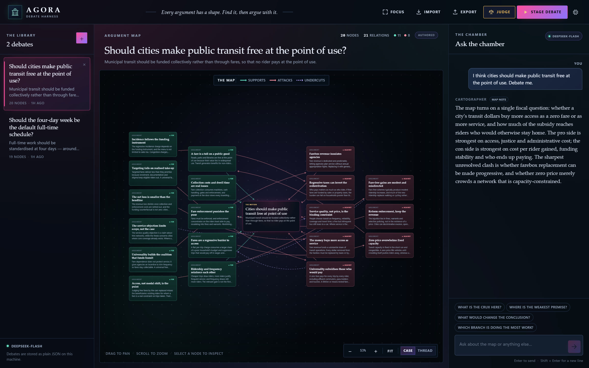
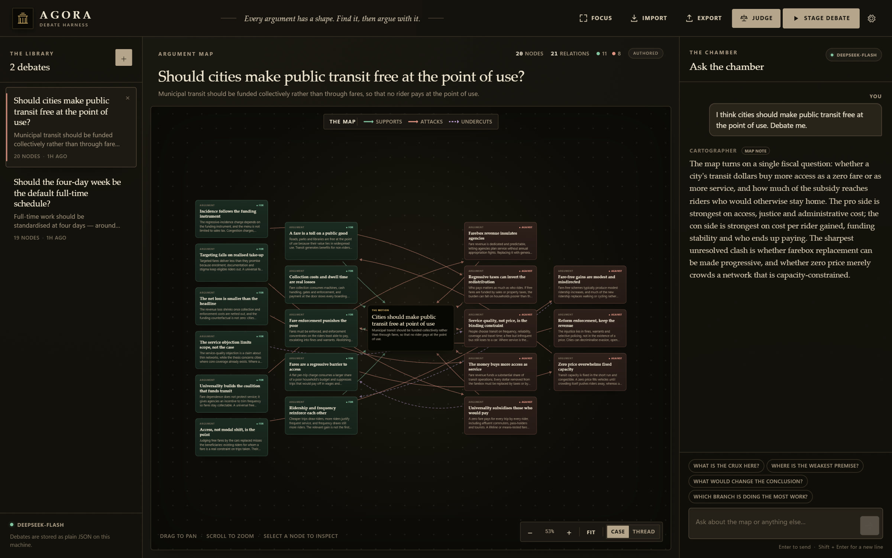

# Agora — a debate harness

> Every argument has a shape. Find it, then argue with it.

Agora turns a position into a map of arguments, lets you interrogate that map, stages the debate as a sequence of turns, and puts the whole thing on trial. It is built for the strongest version of a disagreement, not a chatbot that agrees with you.

[Install](#install-on-windows) · [Using Agora](docs/using-agora.md) · [Judging](docs/judging.md) · [Providers](docs/providers.md) · [Development](docs/development.md)

**Status:** early public beta · Windows x64, unsigned · manual updates · local-first. [Read the security notes →](SECURITY.md)

## What it does

- **Map the argument.** State a position and get a structured graph of supports, attacks, undercuts, premises, and conclusions. The model builds the map; the graph stays yours to edit.
- **Interrogate it.** Open any card for its full text and relations, or ask the chamber where the crux is, which premise is weakest, and what would change the conclusion.
- **Stage it.** Turn the map into a seeded exchange: advocates and challengers take turns, the camera follows the argument, and branches are played in a readable order.
- **Judge it.** The model assesses one argument link at a time, with the motion, thesis, and a compact path for orientation. Deterministic code aggregates the case and decides whether the motion stands or falls.

## How it works

Agora treats the map as the source of truth. The model helps write it, but the judgment does not ask the model to grade the finished case.

- **The model writes into a local graph.** Each authoring call produces structured arguments; each judge call assesses one link. The debate stays a plain graph you can inspect and edit.
- **The verdict is deterministic.** The evidence bar, weighted case, clusters, and standard of proof are applied in code. You can replay a ruling and see exactly what moved.
- **The data is yours.** Debates are local JSON, and the map round-trips through Argdown. There is no account, cloud sync, or telemetry.

Agora is not a fact checker. It judges the argument as written on the record; `✓ Proved` is a procedural finding, not a claim that the facts are true.

## Three appearances

| **Editorial paper** | **Aurora** | **Night Reading Room** |
|:--:|:--:|:--:|
| [](docs/screenshots/workspace-case.jpg) | [](docs/screenshots/workspace-case-aurora.jpg) | [](docs/screenshots/workspace-case-dark.jpg) |
| Warm parchment, olive support, rust attack | Deep indigo chrome, ice-blue and rose | A warm dark reading room |

## Install on Windows

Download `Agora-Setup-0.1.68.exe` and `Agora-Setup-0.1.68.exe.sha256` from [GitHub Releases](https://github.com/andreasamundsen/agora/releases).

1. Back up `%APPDATA%\Agora\data` if you already have debates.
2. Close Agora, then run the installer. It is per-user and needs no administrator rights.
3. Windows will warn that the publisher is unknown. This build is intentionally unsigned: choose **More info → Run anyway**.
4. Verify the download against the checksum from the same release:

   ```powershell
   Get-FileHash .\Agora-Setup-0.1.68.exe -Algorithm SHA256
   ```

There is no auto-update, so a future beta is a manual download and install. Read [`SECURITY.md`](SECURITY.md) before installing.

## Run from source

Requirements: **Node 22.12+** and npm. The project is developed on Node 26.

```bash
npm install
npm run dev
```

Open <http://localhost:5173>. The app works before you connect a model: it seeds two reference debates, and the local scaffolder can still author clearly labelled structural maps.

For the production build:

```bash
npm run build
npm start
```

To build the Windows installer:

```bash
npm run dist
```

## Documentation

| Guide | What it covers |
|---|---|
| [Using Agora](docs/using-agora.md) | The library, map views, editing, the chamber, Stage, and appearance. |
| [Judging](docs/judging.md) | The bench, local link assessments, evidence, the weighted case, playback, and saved judgments. |
| [Providers & models](docs/providers.md) | OpenAI, OpenRouter, DeepSeek, Claude, Gemini, thinking levels, and model settings. |
| [Development & architecture](docs/development.md) | Argdown, the code layout, API, tests, privacy, and known limits. |
| [Documentation index](docs/README.md) | Every guide in one place. |

## Status

Agora is an early public beta, released under the **MIT License**. The Windows build is x64 only, unsigned, and manual-update only. OpenAI, DeepSeek, OpenRouter, Claude, and Gemini have been live-tested; the direct xAI/Grok path has not. Compatibility is strongest with current model IDs, and some **Max** thinking settings may fail or time out.

The app is local-first. Debates and settings live under `%APPDATA%\Agora\data`; when you connect a model, the content you submit goes directly to that provider. There is no telemetry, account, or cloud sync. See [`SECURITY.md`](SECURITY.md) for the current limitations.

## License

MIT. See [`LICENSE`](LICENSE). The software is provided as-is, without warranty; the unsigned beta build is distributed in the same spirit.
